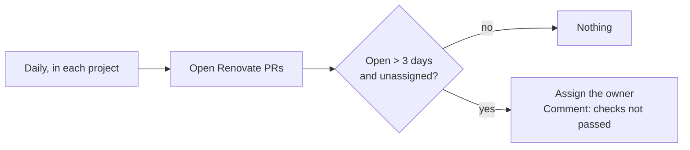

# Design

## Context

Every update that is meant to wait for Ahmed (a major, a workflow tools update, a uv refresh) is already assigned to
him when it opens. Every other Renovate pull request is meant to merge itself within hours of its last check passing,
so one that is still open and unassigned days later has stalled. Renovate reads a branch as pending when any check run
is anything other than success, skipped or neutral, and it never assigns a pending update. The failed update alarm
runs only when a CI job fails.

## Goals / Non-Goals

**Goals:**
- A stalled update reaches Ahmed once, with enough in the comment to see why Renovate holds it

**Non-Goals:**
- Fixing a stall: the comment says which check holds it, Ahmed decides
- Updates already assigned to Ahmed, which already reached him
- pelican-api

## Decisions

### Each project runs the alarm on its own schedule

A reusable workflow, `stalled-update-alarm.yml`, called from a scheduled caller in each project, with the job's own
`github.token`. Like the failed update alarm, it acts only inside the repository that runs it, so no secret and no
list of repositories lives in karkhana.

Rejected: one scheduled workflow in karkhana that scans every project. It needs a token that writes to every repo,
stored as a secret here, and a repo list in a public repo.

Rejected: running it from each project's CI. A stalled pull request gets no new CI runs, so nothing would look at it.

### Three days from opening

A green update merges on Renovate's next run, hours after its last check. Three days covers a weekend and a slow
Renovate day, and would have brought ahmedavais.com's group to Ahmed on 2026-11-19 instead of never. The age counts
from when the pull request opened, so a weekly group that Renovate rebases every Monday still ages.

Rejected: a week. A stall costs a week of updates already, and nothing legitimate keeps an unassigned update open
that long.

### Assign and comment, once

Assignment is how every other update reaches Ahmed: GitHub notifies the assignee. The comment lists each check run
and status context that has not passed, with its state, so a cancelled or still-pending check shows at a glance.
Assigning also makes the alarm fire once: an assigned pull request is skipped on later runs.

Rejected: an issue per stall. The policy has no standing issue, and the pull request is where Ahmed acts.

Rejected: failing the scheduled run so GitHub emails it. A run started by a schedule emails whoever last edited the
cron, and a red run says nothing about which pull request stalled.

### The decision is a script, the GitHub calls stay in the workflow

`updates/stalled-update.js` decides which pull requests have stalled and writes the comment, from the JSON that
`gh pr list --json` returns and the current time. The workflow fetches that JSON, runs the CLI from karkhana's main
checkout and does the assigning and commenting. The script needs no network, so its tests run on fixtures.

## Risks / Trade-offs

- [A stall in its first three days goes unheard] → accepted; it reaches Ahmed on day four
- [Renovate stops assigning an update it means to hold] → the alarm then treats it as stalled and assigns it, which is
  the outcome the policy asks for anyway
- [GitHub disables a schedule in a repo with no activity for 60 days] → these repos get weekly Renovate pushes

## Migration Plan

Merge the workflow, then add the caller to each project, one pull request each. Removing a caller turns the alarm
off for that project.
