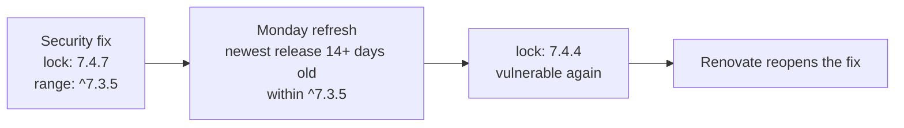

# Design

## Context

Renovate opens security fixes with `rangeStrategy: "update-lockfile"` by default: only the lock file moves, and the
manifest keeps a range such as `^7.3.5`. Observed lock file refreshes resolved only releases at least 14 days old. The
docs don't say what enforces that, but npm's `--before` set to 14 days before the refresh reproduces the observed
versions exactly. So a refresh could take a fixed dependency back to the newest release old enough, below the fix.

## Goals / Non-Goals

**Goals:**
- A security fix for a direct dependency can't be undone by a later refresh or update
- Any update that lowers a direct dependency is red on its pull request and comes to Ahmed

**Non-Goals:**
- Python lock files (`uv.lock`): the check reads npm's `package-lock.json` only. Whether uv refreshes show the same
  behavior is unknown
- Transitive dependencies: their fixes only arrive with the refresh, and a refresh lowering one isn't caught
- Finding what enforces the 14 days inside Renovate's hosted runs

## Decisions

### The fix raises the range

`vulnerabilityAlerts` sets `rangeStrategy: "bump"`, so the fix moves `^7.3.5` to `^7.4.7`. Any resolver, whatever age
rule it applies, then has no version below the fix to pick.

Rejected: dropping the 14-day wait from lock file refreshes. It removes the supply-chain buffer from every transitive
dependency to protect a handful of direct ones.

### The check compares locked versions of direct dependencies

For each `package-lock.json` the pull request changes, the check reads the root package's `dependencies`,
`devDependencies`, `optionalDependencies` and `peerDependencies`, and compares each one's locked version on the base
branch with the pull request's. A lower version fails the check with the name and both versions. A version that isn't
semver, such as a git dependency's, is skipped: there is no order to compare.

It runs only on pull requests that Renovate opened, like the failed update alarm.

Rejected: comparing manifest ranges. The lock file is what gets installed; the incident never touched a range.

### The check is a reusable workflow, its logic a tested module

`.github/workflows/downgrade-guard.yml` checks out the project with its history and karkhana's main beside it, like the
adversarial review, and runs `updates/downgrade-guard-cli.js`. The comparison lives in `updates/downgrade-guard.js`,
tested with `node --test`. Version order is written here, not taken from the `semver` package: the script runs from
a checkout with no `npm ci`, and karkhana ships no runtime dependencies to the projects that install it.

## Risks / Trade-offs

- With the range raised, a refresh in the fix's first 14 days may find no release old enough inside the range. npm
  then fails with `notarget` and writes no lock file. Renovate's docs say it then retries without `--before`, so that
  refresh takes transitive releases of any age. `unattended-lock-refresh` adds a check for that. The first security
  fix after this change is still watched
- The check trusts the base branch's lock file. A downgrade that already reached main isn't reported again
