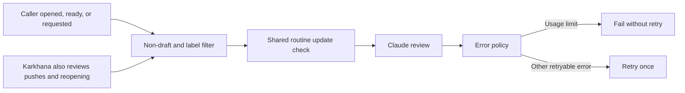

## Review on request

The caller template reviews a non-draft pull request when it opens, becomes ready for review, or receives the `review-requested` label. A new push in a caller adopting this template does not request another review. Remove and reapply the label to request another review of the current head.

Karkhana keeps automatic reviews on non-draft PR pushes and reopening, as well as the template's events. Ahmed chose this exception on 2026-10-30 because changes here reach every caller at `@main`.

The caller owns event selection because a reusable workflow cannot subscribe to events its caller does not receive. This change updates this repository's caller and the README template. Other callers retain their existing event selection until their own rollout changes. The shared retry policy reaches callers at `@main` after merge.

Keep the own-branch restriction, routine dependency update skip, and main-branch review brief. Drafts and unrelated labels do not request a review. The label name is a reversible convention; this repository has no existing review label.

Keep error diagnostics separate from the decision to retry. Detect usage-limit messages before the diagnostic is shortened. Preserve one retry for transient errors such as server overload or a temporary HTTP 429. A usage-limit failure must remain a failed job.

This public repository records generic workflow behavior and its own verification only. Caller rollout inventory belongs in the private factory map.
