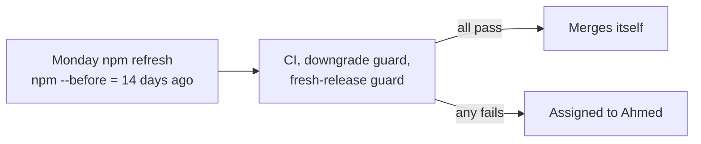

# Design

## Context

Renovate gates every update on `renovate/stability-days`, which passes once the update's release is at least
`minimumReleaseAge` old. A lock file refresh has no single release, so with the default
`minimumReleaseAgeBehaviour: "timestamp-required"` the status stays pending forever. That is why `lockFileMaintenance`
sets `automerge: false` and Renovate assigns the refresh to Ahmed.

Renovate's docs say that when `minimumReleaseAge` is set, Renovate passes `--before=<now minus the age>` to npm while
it generates a lock file. The incident in `keep-security-fixes` matches: refreshes on 2026-11-16 and 2026-11-18 locked
astro at exactly the newest release older than 14 days. Since Renovate 44.236.0, the experimental
`minimumReleaseAgePackageManagerSync` flag skips the stability wait for a refresh whose package manager enforces the
age, and Renovate's source counts npm as enforcing it whenever it passes `--before`. Mend's runs used 44.257.3 on
2026-11-23.

## Goals / Non-Goals

**Goals:**
- An npm lock file refresh merges itself when its checks pass, so Ahmed sees it only when one fails
- No refresh takes a release younger than 14 days without a check failing

**Non-Goals:**
- uv lock files: Renovate doesn't enforce the age for uv, so the flag can't release a uv refresh. buzzword-weather's
  refresh keeps coming to Ahmed
- Workflow tool updates and majors, which keep coming to Ahmed

## Decisions

### Trust npm's `--before` through the flag

The preset sets `minimumReleaseAgePackageManagerSync: true` at the top level. Renovate only accepts it there or in a
manager's config, not in `packageRules`.

Rejected: `min-release-age=14` in each project's `.npmrc`, the way back the add-dependency-updates design named. npm
then refuses every release younger than 14 days, including the fixed version of a security fix: npm 12.2.3 failed
`astro@7.4.13` and `astro@^7.4.13` with `notarget`. Security fixes would wait 14 days again.

Rejected: `minimumReleaseAgeBehaviour: "timestamp-optional"` for refreshes. It releases the refresh too, but trusts
nothing to enforce the age.

### Merge only npm refreshes

A `packageRules` entry matching `lockFileMaintenance` updates of the `npm` manager sets `automerge: true`, and
`lockFileMaintenance` keeps `automerge: false` for every other manager. Renovate's `flatten.ts` applies `packageRules`
after merging the `lockFileMaintenance` block, so the rule wins.

Rejected: `automerge: true` inside `lockFileMaintenance`. A uv refresh would then wait on a stability status that
never passes, and Renovate assigns nobody to an update it means to merge itself, so the refresh would sit unseen.

### Validate with the first release that knows the flag

`validate-renovate` runs Renovate 44.236.0. 44.206.3 and 44.230.0 reject the flag as an unknown option. 44.236.0 also
requires `dependencyDashboard: false` written as `{ "enabled": false }`, which 44.206.3 rejects, so the pin and that
change ship together. 44.236.0 was released on 2026-11-12 at 13:43 UTC, so it is 14 days old only from 2026-11-26 at
that time. The pull request waits until then, under karkhana's own rule.

### Catch a refresh that takes young releases

The docs say that when `--before` fails with `ETARGET`, because a locked version is younger than the cutoff, Renovate
retries without it. A security fix raises a direct dependency's range to a release under 14 days old, so the next
Monday's refresh can hit exactly that and then take every transitive release, however new. A check like the downgrade
guard closes this: for each `package-lock.json` a lock file refresh changes, it reads each newly locked version's
publish date from the registry and fails on any younger than 14 days, unless a manifest's range requires it.

## Risks / Trade-offs

- The flag is experimental, and Renovate says its behavior may change. If a change stops releasing refreshes, they go
  back to sitting pending, and a stuck refresh assigns nobody. The Monday watch task catches the first one
- Until the fresh-release guard lands, a refresh in the 14 days after a direct security fix can merge fresh transitive
  releases unattended. Ahmed chose to ship the flag first and the guard next, on 2026-11-25
- Pull requests that touch `.github/workflows/ci.yml`, such as the open workflow tools update, will conflict on the
  validator pin. Renovate rebases its own
